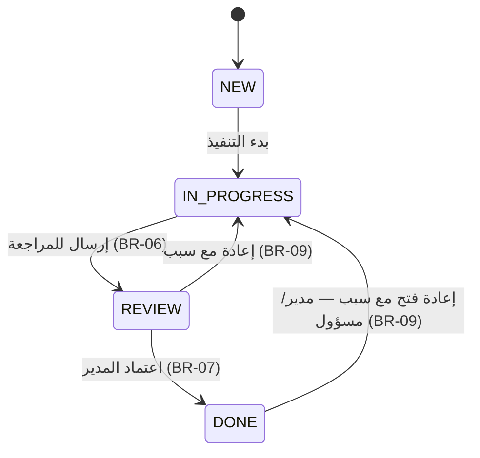

# BRD — نظام إدارة المهام (مدار)

15 Oct 2026 · @yahya

## 1. المقدمة والنطاق

يُبنى نظام إدارة المهام وحدةً في بوابة مدار، لتمكين موظفي الوزارة من إنشاء المهام وإسنادها ومتابعتها حتى الإنجاز، مع ربط كل مهمة بالطلب الذي نشأت منه. هذه الوثيقة هي المرجع الوحيد لبناء النظام كاملاً (قاعدة البيانات، الواجهات الخلفية، الشاشات، قواعد الأعمال).

**داخل النطاق (الإصدار الأول):**

- إنشاء المهام وتعديلها وإسنادها وربطها برقم طلب.
- دورة حياة المهمة بأربع حالات: جديدة، قيد التنفيذ، قيد المراجعة، مكتملة.
- المهام الفرعية (قائمة تحقق) وحساب نسبة التقدم تلقائياً.
- التعليقات وسجل النشاط (مسار تدقيق).
- عرض القائمة وعرض اللوحة (كانبان)، مع البحث والتصفية.
- مؤشرات الأداء وتنبيهات المهام المتأخرة داخل النظام.

**خارج النطاق:** تكامل البريد والرسائل النصية، تطبيق الجوال، المهام المتكررة، إدارة المشاريع ومخططات جانت. تُدرج في إصدار لاحق.

**المرجع البصري:** التصور التفاعلي «مدار — إدارة المهام». أي تعارض بين التصور وهذه الوثيقة تُقدَّم فيه الوثيقة.

> **تعليمات لـ Claude Code:** صدِّر هذه الوثيقة بصيغة Markdown وضعها في جذر المستودع باسم `docs/BRD.md`، ثم اطلب: «ابنِ النظام وفق docs/BRD.md حسب خطة التنفيذ في القسم 9». معرّفات المتطلبات (FR-xx وBR-xx وAC-xx) تُذكر في تعليقات الشيفرة وأسماء الاختبارات للتتبّع.

## 2. الأدوار والصلاحيات

أربعة أدوار، والصلاحيات تُفرض في الواجهات الخلفية وليس في الواجهة فقط. المستخدم ينتمي لإدارة واحدة، وله دور واحد.

| الدور | الرمز | يرى | ينشئ ويُسند | يغيّر الحالة | يعتمد الإكمال | يحذف |
|---|---|---|---|---|---|---|
| موظف | `EMPLOYEE` | المهام المسندة إليه والتي أنشأها | لنفسه فقط | مهامه حتى «قيد المراجعة» | لا | لا |
| رئيس قسم / مدير إدارة | `MANAGER` | كل مهام إدارته | لموظفي إدارته | كل مهام إدارته | نعم | مهام إدارته غير المكتملة |
| مستعرض | `VIEWER` | مهام إدارته (قراءة فقط) | لا | لا | لا | لا |
| مسؤول النظام | `ADMIN` | كل المهام | لأي مستخدم | كل المهام | نعم | نعم + إدارة المستخدمين والإدارات |

الحسابات التجريبية (Seed) تشمل الموظفين السبعة والمهام العشر الظاهرة في التصور، مع حساب ADMIN وحساب MANAGER لإدارة التحول الرقمي.

## 3. المتطلبات الوظيفية

٣٢ متطلباً موزّعة على سبع مجموعات. الأولوية: **يجب** = شرط للإطلاق، **ينبغي** = مطلوب ما لم يُؤجَّل بقرار.

| الرمز | المتطلب | الأولوية |
|---|---|---|
| **الدخول والهوية** | | |
| FR-01 | تسجيل الدخول بالبريد المؤسسي وكلمة المرور، مع طبقة مصادقة قابلة للاستبدال بـ SSO (Azure AD / نفاذ) لاحقاً | يجب |
| FR-02 | عرض اسم المستخدم وإدارته والحرف الأول من اسمه في الشريط العلوي | يجب |
| FR-03 | تسجيل الخروج وانتهاء الجلسة بعد 30 دقيقة من عدم النشاط | يجب |
| **إنشاء المهام** | | |
| FR-04 | إنشاء مهمة بالحقول: العنوان (إلزامي)، الوصف، المسؤول، الأولوية، تاريخ الاستحقاق، رقم الطلب المرتبط | يجب |
| FR-05 | توليد رقم مهمة تلقائي بالصيغة T-#### تسلسلياً وغير قابل للتعديل | يجب |
| FR-06 | إضافة مهام فرعية عند الإنشاء أو بعده (نص + حالة منجزة/غير منجزة + ترتيب) | يجب |
| FR-07 | إرفاق ملفات بالمهمة (حتى 25 ميجابايت للملف) | ينبغي |
| **متابعة المهام** | | |
| FR-08 | تغيير حالة المهمة من لوحة التفاصيل وفق مصفوفة الانتقالات (BR-05) | يجب |
| FR-09 | تعليم المهام الفرعية بمربع اختيار، مع تحديث نسبة التقدم فوراً (BR-08) | يجب |
| FR-10 | إضافة تعليق نصي على المهمة | يجب |
| FR-11 | تسجيل كل تغيير (إنشاء، حالة، إسناد، أولوية، استحقاق) في سجل النشاط مع الفاعل والوقت والقيمة القديمة والجديدة | يجب |
| FR-12 | عرض التعليقات وسجل النشاط في خط زمني واحد مرتّب تصاعدياً | يجب |
| FR-13 | تعديل بيانات المهمة (العنوان، الوصف، المسؤول، الأولوية، الاستحقاق) لمن له الصلاحية | يجب |
| FR-14 | إعادة مهمة «قيد المراجعة» إلى «قيد التنفيذ» مع سبب إلزامي | يجب |
| **العرض والبحث** | | |
| FR-15 | عرض القائمة: جدول بالأعمدة رقم المهمة، العنوان + الإدارة + الطلب، المسؤول، الأولوية، الاستحقاق + المدة المتبقية، التقدم، الحالة | يجب |
| FR-16 | عرض اللوحة: أربعة أعمدة حسب الحالة مع عدّاد لكل عمود | يجب |
| FR-17 | سحب البطاقة بين أعمدة اللوحة لتغيير الحالة (مع بديل بلوحة المفاتيح) | ينبغي |
| FR-18 | بحث نصي في رقم المهمة والعنوان واسم المسؤول ورقم الطلب واسم الإدارة | يجب |
| FR-19 | تصفية حسب الحالة (شرائح مع عدّادات) والأولوية والمسؤول ونطاق تاريخ الاستحقاق | يجب |
| FR-20 | قوائم جاهزة في القائمة الجانبية: جميع المهام، مهامي، المتأخرة، المكتملة — مع عدّاد لكل منها | يجب |
| FR-21 | الفرز حسب أي عمود، والافتراضي: المتأخرة أولاً ثم الأقرب استحقاقاً | يجب |
| FR-22 | ترقيم الصفحات (25 مهمة للصفحة) وعبارة «عرض X من Y» | يجب |
| FR-23 | حالة فارغة عند عدم وجود نتائج، مع زر «إعادة ضبط التصفية» | يجب |
| FR-24 | حفظ آخر طريقة عرض وتصفية لكل مستخدم في رابط الصفحة (Query string) | ينبغي |
| **المؤشرات والتنبيهات** | | |
| FR-25 | أربع بطاقات مؤشرات: إجمالي المهام (ومنها الجديدة)، قيد العمل (ومنها قيد المراجعة)، المتأخرة (وما يستحق خلال يومين)، المكتملة (ومعدل الإنجاز) | يجب |
| FR-26 | المؤشرات تحترم نطاق رؤية المستخدم (BR-01) | يجب |
| FR-27 | جرس تنبيهات بعدد المهام المتأخرة، ينقل الضغط عليه إلى قائمة «المتأخرة» | يجب |
| FR-28 | تنبيه داخل النظام للمسؤول عند إسناد مهمة إليه أو إعادتها من المراجعة، وللمنشئ عند اكتمالها | ينبغي |
| **التغذية الراجعة** | | |
| FR-29 | رسالة تأكيد مؤقتة (Toast) بعد الإنشاء وتغيير الحالة وإضافة التعليق | يجب |
| FR-30 | رسائل خطأ عربية واضحة بجانب الحقل المعني | يجب |
| **الإدارة** | | |
| FR-31 | إدارة المستخدمين (إضافة، تعطيل، تغيير الدور والإدارة) لـ ADMIN | يجب |
| FR-32 | إدارة الإدارات (الاسم، المدير) لـ ADMIN | يجب |

## 4. قواعد الأعمال

كل قاعدة تُفرض في الطبقة الخدمية (Service layer) بالخادم، وتُكرَّر في الواجهة للتجربة فقط. أي مخالفة تُرجِع خطأ 422 برسالة عربية ورمز القاعدة.

| الرمز | القاعدة |
|---|---|
| BR-01 | نطاق الرؤية: EMPLOYEE يرى ما أُسند إليه أو أنشأه، MANAGER وVIEWER مهام إدارتهم (إدارة المسؤول)، ADMIN كل المهام. يُطبّق النطاق على القوائم والمؤشرات والبحث والتفاصيل، والمهمة خارج النطاق تُرجِع 404. |
| BR-02 | المهمة الجديدة تبدأ بحالة NEW، والمسؤول الافتراضي هو المنشئ، والأولوية الافتراضية MEDIUM. |
| BR-03 | تاريخ الاستحقاق إلزامي ولا يقل عن تاريخ اليوم (بتوقيت الرياض) عند الإنشاء أو التعديل. |
| BR-04 | المهمة متأخرة إذا كان تاريخ استحقاقها قبل اليوم وحالتها ليست DONE، وقريبة الاستحقاق إذا بقي بين 0 ويومين. تُحسب لحظة الاستعلام ولا تُخزَّن. النص المساعد: «تستحق اليوم»، «متبقٍ N أيام»، «متأخرة N أيام»، «منجزة» مع صيغ العدد العربية الصحيحة (يوم واحد، يومين، 3–10 أيام، 11+ يومًا). |
| BR-05 | انتقالات الحالة المسموحة فقط هي المبيّنة في مخطط دورة الحياة أدناه، وأي انتقال آخر يُرفض. |
| BR-06 | الانتقال إلى REVIEW يشترط إنجاز جميع المهام الفرعية إن وُجدت. |
| BR-07 | الانتقال إلى DONE يكون من REVIEW فقط وبواسطة MANAGER أو ADMIN، ويُسجَّل completed_at وcompleted_by. |
| BR-08 | نسبة التقدم = (المهام الفرعية المنجزة ÷ إجماليها) × 100 مقرّبة لأقرب عدد صحيح. بلا مهام فرعية = 0%، والمهمة DONE = 100% دائماً. تُحسب ولا تُدخل يدوياً. |
| BR-09 | إعادة مهمة من REVIEW إلى IN_PROGRESS أو إعادة فتح مهمة DONE تتطلب سبباً نصياً (10 أحرف على الأقل) يُحفظ في سجل النشاط. إعادة الفتح لـ MANAGER وADMIN فقط. |
| BR-10 | المهمة DONE مقفلة: لا تُعدَّل بياناتها ولا مهامها الفرعية، ويُسمح بالتعليق فقط. |
| BR-11 | رقم المهمة T- + تسلسل يبدأ من 1001، فريد ولا يُعاد استخدامه حتى بعد الحذف (تسلسل قاعدة بيانات). |
| BR-12 | رقم الطلب المرتبط اختياري، وإن أُدخل فبالصيغة REQ-YYYY-NNNN (التعبير `^REQ-\d{4}-\d{4}$`). |
| BR-13 | المسؤول يجب أن يكون مستخدماً نشطاً. MANAGER يُسند داخل إدارته فقط، وEMPLOYEE لنفسه فقط. تغيير المسؤول يُسجَّل ويُشعر المسؤول الجديد. |
| BR-14 | الحذف منطقي (deleted_at) وللمهام غير المكتملة فقط، والمحذوفة لا تظهر في أي قائمة أو مؤشر. |
| BR-15 | التعليقات وسجل النشاط غير قابلة للتعديل أو الحذف (Append-only). |
| BR-16 | معدل الإنجاز = المكتملة ÷ إجمالي المهام ضمن نطاق المستخدم × 100. |
| BR-17 | أطوال الحقول: العنوان 5–200 حرف، الوصف حتى 2000، المهمة الفرعية حتى 200، التعليق 1–1000، وحد 20 مهمة فرعية للمهمة. تُزال المسافات الطرفية قبل التحقق. |
| BR-18 | التواريخ تُخزَّن بـ UTC (عدا due_date تاريخاً بلا وقت) وتُعرض بتوقيت Asia/Riyadh وبالتقويم الميلادي وأسماء الأشهر العربية (يناير…ديسمبر). |

### مخطط دورة الحياة

خمسة انتقالات فقط مسموحة، وما عداها يُرفض. الوصول إلى «مكتملة» لا يكون إلا من «قيد المراجعة» وباعتماد المدير، وكل إعادة للخلف تحتاج سبباً مكتوباً.



## 5. نموذج البيانات

سبعة جداول في PostgreSQL. المفاتيح uuid، والتعدادات Enums في قاعدة البيانات، وكل جدول فيه created_at وupdated_at. العلاقات: الإدارة 1←N المستخدم، المستخدم 1←N المهمة (مسؤولاً ومنشئاً)، المهمة 1←N المهام الفرعية والنشاط والمرفقات.

**Enums:** `role` = EMPLOYEE | MANAGER | VIEWER | ADMIN · `task_status` = NEW | IN_PROGRESS | REVIEW | DONE · `priority` = HIGH | MEDIUM | LOW · `activity_type` = COMMENT | CREATED | STATUS_CHANGED | ASSIGNEE_CHANGED | PRIORITY_CHANGED | DUE_CHANGED | SUBTASK_TOGGLED | REOPENED

### departments

| الحقل | النوع | ملاحظات |
|---|---|---|
| id | uuid PK | |
| name_ar | varchar(150) | فريد |
| manager_id | uuid FK → users | اختياري |

### users

| الحقل | النوع | ملاحظات |
|---|---|---|
| id | uuid PK | |
| full_name_ar | varchar(150) | |
| email | varchar(200) | فريد، بأحرف صغيرة |
| password_hash | varchar | argon2 أو bcrypt، يُهمل عند SSO |
| role | role | |
| department_id | uuid FK → departments | |
| is_active | boolean | افتراضي true |

### tasks

| الحقل | النوع | ملاحظات |
|---|---|---|
| id | uuid PK | |
| code | varchar(12) | فريد، T- + nextval('task_code_seq') يبدأ من 1001 (BR-11) |
| title | varchar(200) | BR-17 |
| description | text | اختياري، حتى 2000 |
| status | task_status | افتراضي NEW |
| priority | priority | افتراضي MEDIUM |
| due_date | date | إلزامي (BR-03) |
| request_ref | varchar(13) | اختياري (BR-12)، مفهرس |
| assignee_id | uuid FK → users | |
| department_id | uuid FK → departments | إدارة المسؤول لحظة الإسناد، لتطبيق BR-01 |
| created_by_id | uuid FK → users | |
| completed_at | timestamptz | عند DONE |
| completed_by_id | uuid FK → users | عند DONE |
| deleted_at | timestamptz | حذف منطقي (BR-14) |

فهارس: (department_id, status)، (assignee_id, status)، due_date، request_ref.

### subtasks

| الحقل | النوع | ملاحظات |
|---|---|---|
| id | uuid PK | |
| task_id | uuid FK → tasks | حذف متتابع |
| text | varchar(200) | |
| is_done | boolean | افتراضي false |
| sort_order | int | |

### task_activities — التعليقات وسجل النشاط في جدول واحد، Append-only (BR-15)

| الحقل | النوع | ملاحظات |
|---|---|---|
| id | uuid PK | |
| task_id | uuid FK → tasks | مفهرس مع created_at |
| actor_id | uuid FK → users | |
| type | activity_type | |
| body | text | نص التعليق أو سبب الإعادة |
| old_value | jsonb | للتغييرات |
| new_value | jsonb | للتغييرات |
| created_at | timestamptz | |

### attachments (FR-07)

| الحقل | النوع | ملاحظات |
|---|---|---|
| id | uuid PK | |
| task_id | uuid FK → tasks | |
| file_name | varchar(255) | |
| mime_type | varchar(100) | |
| size_bytes | int | ≤ 26214400 |
| storage_key | varchar | مسار التخزين |
| uploaded_by_id | uuid FK → users | |

### notifications (FR-28)

| الحقل | النوع | ملاحظات |
|---|---|---|
| id | uuid PK | |
| user_id | uuid FK → users | المستلم |
| task_id | uuid FK → tasks | |
| message_ar | varchar(300) | |
| read_at | timestamptz | فارغ = غير مقروء |

## 6. الشاشات وهوية مدار

الواجهة عربية بالكامل من اليمين لليسار (`<html lang="ar" dir="rtl">`)، بالنمط الداكن لمدار، وتطابق التصور التفاعلي بصرياً.

**رموز التصميم (Design tokens):**

| الرمز | القيمة | الاستخدام |
|---|---|---|
| `--bg` | #0B2630 | خلفية الصفحة والحقول |
| `--header` | #082029 | الشريط العلوي |
| `--surface` | #10303B | البطاقات والقائمة الجانبية |
| `--surface-2` | #0F2D38 | اللوحة الجانبية والنوافذ |
| `--border` / `--border-strong` | #1B3E4B / #2B5564 | الحدود / حدود الحقول |
| `--primary` | #1E6A5E | الأزرار الرئيسية والعنصر النشط |
| `--accent` | #49BAA6 | التركيز وأشرطة التقدم وعناوين الأقسام |
| `--ink` / `--ink-muted` | #E8F1F1 / #B9CDD1 | النص / النص الثانوي |
| الحالات | جديدة #9CC9F0 · قيد التنفيذ #F0CF7E · قيد المراجعة #C9B3F2 · مكتملة #6FD3BF | نص الشارة على اللون نفسه بشفافية 15% |
| الأولويات | عالية #F5A285 · متوسطة #F0CF7E · منخفضة #B9CDD1 | النمط نفسه |
| الخط | DIN Next LT Arabic → Readex Pro → Tahoma | DIN مرخّص، وReadex Pro من Google Fonts بديلاً |
| الزوايا | البطاقات 14px · الحقول 10px · الأزرار 50px (حبّية) | |

**الشعار:** نسخة مدار الفاتحة (`public/madaar-logo-light.png`) بارتفاع 44px في أقصى يمين الشريط العلوي، ولا يُعاد رسمه أو تلوينه.

**الشاشات:**

| المسار | الشاشة | المحتوى | المتطلبات |
|---|---|---|---|
| `/login` | تسجيل الدخول | الشعار، البريد، كلمة المرور، زر الدخول | FR-01 |
| `/tasks` | إدارة المهام | الشريط العلوي (شعار، «إدارة المهام»، جرس التنبيهات، المستخدم)، القائمة الجانبية (أربع قوائم + معدل الإنجاز)، العنوان وزر «مهمة جديدة»، أربع بطاقات مؤشرات، شريط البحث والتصفية ومبدّل «قائمة / لوحة»، ثم الجدول أو اللوحة | FR-15 إلى FR-27 |
| `/tasks?task=T-1041` | لوحة تفاصيل المهمة | تنزلق من اليسار بعرض 560px: الرقم والحالة، العنوان والوصف، بيانات المهمة (ستة حقول)، أزرار تغيير الحالة (المسموح بها فقط مفعّلة)، المهام الفرعية ونسبة التقدم، التعليقات وسجل النشاط، حقل التعليق | FR-08 إلى FR-14 |
| نافذة في `/tasks` | مهمة جديدة / تعديل | العنوان*، الوصف، المسؤول، الأولوية، تاريخ الاستحقاق، رقم الطلب، المهام الفرعية، المرفقات | FR-04 إلى FR-07، FR-13 |
| نافذة في التفاصيل | سبب الإعادة | حقل نصي إلزامي + تأكيد | FR-14، BR-09 |
| `/admin/users` · `/admin/departments` | الإدارة | جدول + نموذج إضافة/تعديل | FR-31، FR-32 |

**قواعد الواجهة:** أهداف اللمس 44px على الأقل · حلقة تركيز 2px بلون `--accent` لا تُزال · أزرار ومدخلات حقيقية وaria-label لأزرار الأيقونات · النوافذ تُغلق بـ Esc وتحبس التركيز · التصميم متجاوب حتى عرض 360px (تنتقل القائمة الجانبية فوق المحتوى، والجدول واللوحة تتمرّران أفقياً) · تباين النص 4.5:1 · الحالة لا تُبلَّغ باللون وحده (نص الشارة دائماً) · أيقونات خطية (Lucide) بلا رموز تعبيرية · حالات التحميل هياكل رمادية (Skeleton) لا مؤشرات دوّارة.

## 7. واجهات API

REST بصيغة JSON تحت `/api/v1`، وكل نقطة تتطلب جلسة صالحة وتطبّق BR-01. الخطأ بالشكل:

```json
{ "error": { "code": "BR-06", "message": "يجب إنجاز جميع المهام الفرعية قبل الإرسال للمراجعة", "field": null } }
```

المدخلات تُتحقَّق بمخطط Zod مشترك بين الواجهة والخادم.

| الطريقة | المسار | الوظيفة | القواعد |
|---|---|---|---|
| POST | `/auth/login` · `/auth/logout` | الدخول والخروج | FR-01، FR-03 |
| GET | `/me` | المستخدم الحالي ودوره وإدارته | FR-02 |
| GET | `/tasks?view=all\|mine\|overdue\|done&status=&priority=&assigneeId=&dueFrom=&dueTo=&q=&sort=&page=&pageSize=25` | قائمة مرقّمة + total، وكل عنصر بحقول محسوبة progress وisOverdue وdaysToDue | BR-01، BR-04، BR-08 |
| GET | `/tasks/stats` | المؤشرات وعدّادات القائمة الجانبية والحالات بنفس عوامل التصفية | FR-20، FR-25، BR-16 |
| POST | `/tasks` | إنشاء مهمة (مع مهام فرعية اختيارية) | BR-02، BR-03، BR-11، BR-12، BR-13 |
| GET | `/tasks/:code` | التفاصيل + المهام الفرعية + النشاط + المرفقات + allowedTransitions | BR-01، BR-05 |
| PATCH | `/tasks/:code` | تعديل البيانات (لا تشمل الحالة) | BR-10، BR-13 |
| POST | `/tasks/:code/transition` | `{ "to": "REVIEW", "reason"?: "…" }` — تغيير الحالة في معاملة واحدة مع سجل النشاط والتنبيه | BR-05 إلى BR-09 |
| DELETE | `/tasks/:code` | حذف منطقي | BR-14 |
| POST · PATCH · DELETE | `/tasks/:code/subtasks` · `/subtasks/:id` | إضافة وتعليم وحذف المهام الفرعية | BR-08، BR-10، BR-17 |
| POST | `/tasks/:code/comments` | إضافة تعليق | BR-15، BR-17 |
| POST · GET | `/tasks/:code/attachments` · `/attachments/:id` | رفع وتنزيل المرفقات (multipart) | FR-07 |
| GET · POST | `/notifications` · `/notifications/:id/read` | تنبيهات المستخدم | FR-28 |
| GET | `/users?active=true&departmentId=` | قائمة المسؤولين المسموح بالإسناد إليهم | BR-13 |
| CRUD | `/admin/users` · `/admin/departments` | الإدارة، لـ ADMIN فقط | FR-31، FR-32 |

**رموز الحالة:** 200/201 نجاح، 400 مدخلات غير صالحة، 401 غير مسجّل، 403 صلاحية، 404 غير موجود أو خارج النطاق، 409 تعارض تحديث (حقل updated_at في PATCH)، 422 مخالفة قاعدة أعمال.

## 8. المتطلبات غير الوظيفية والتقنيات

التقنيات المقترحة افتراض مبدئي، ويمكن استبدالها بمعيار الوزارة المعتمد قبل بدء التنفيذ دون تغيير بقية الوثيقة.

| الطبقة | الاختيار |
|---|---|
| الإطار | Next.js 15 (App Router) + TypeScript بوضع strict — الواجهة ومسارات API في مشروع واحد |
| قاعدة البيانات | PostgreSQL 16 عبر Prisma (ترحيلات + Seed) |
| المصادقة | Auth.js بموفّر Credentials، قابل لإضافة Azure AD لاحقاً |
| الواجهة | Tailwind CSS برموز مدار (القسم 6)، Radix UI للنوافذ والقوائم، TanStack Query، dnd-kit للسحب |
| التحقق | Zod مشترك |
| الاختبار | Vitest للقواعد والخدمات، Playwright للمسارات الكاملة |
| التشغيل | Docker Compose (التطبيق + PostgreSQL)، وملف .env.example |
| التخزين | مجلد محلي للمرفقات في التطوير، بواجهة قابلة للاستبدال بتخزين كائنات S3 |

**غير الوظيفية:**

| الرمز | المتطلب |
|---|---|
| NFR-01 | زمن استجابة قائمة المهام أقل من 500 مللي ثانية لـ 10,000 مهمة |
| NFR-02 | كلمات المرور مُجزأة، الجلسات بملفات تعريف HttpOnly وSecure وSameSite=Lax، وحماية CSRF، وتحديد محاولات الدخول (5 في 15 دقيقة) |
| NFR-03 | التوافق مع ضوابط الأمن السيبراني الأساسية (NCA ECC) ونظام حماية البيانات الشخصية، واستضافة البيانات داخل المملكة |
| NFR-04 | الترابط مع WCAG 2.1 AA |
| NFR-05 | سجل تدقيق كامل لكل تغيير على المهام (FR-11) |
| NFR-06 | دعم آخر إصدارين من Chrome وEdge وSafari |
| NFR-07 | تغطية اختبار لا تقل عن 80% لطبقة الخدمات، وكل قاعدة BR لها اختبار واحد على الأقل |
| NFR-08 | النصوص العربية في ملف موارد واحد (messages/ar.json) لتسهيل المراجعة والترجمة لاحقاً |

## 9. معايير القبول وخطة التنفيذ

يُقبَل النظام عند نجاح معايير القبول التالية كلها كاختبارات آلية، على بيانات Seed بتاريخ مثبّت 2026-10-15.

| الرمز | المعطى | الإجراء | النتيجة المتوقعة |
|---|---|---|---|
| AC-01 | موظف في إدارة التحول الرقمي | يفتح /tasks | يرى مهامه فقط، والمؤشرات محسوبة منها |
| AC-02 | مستخدم ينشئ مهمة بلا عنوان | يضغط «إنشاء المهمة» | تظهر «يرجى إدخال عنوان المهمة» تحت الحقل ولا تُنشأ المهمة |
| AC-03 | بيانات صحيحة | إنشاء مهمة | تظهر أعلى القائمة برقم T-#### تالٍ وحالة «جديدة»، مع رسالة تأكيد ونشاط CREATED |
| AC-04 | مهمة استحقاقها 2026-10-13 بحالة قيد التنفيذ | عرض القائمة | تظهر «متأخرة يومين»، وتُحتسب في عدّاد الجرس وقائمة «المتأخرة» |
| AC-05 | مهمة بـ 4 مهام فرعية منجز منها 2 | تعليم مهمة فرعية ثالثة | يتغير التقدم من 50% إلى 75% في التفاصيل والقائمة واللوحة |
| AC-06 | مهمة بمهام فرعية غير منجزة | نقلها إلى «قيد المراجعة» | يُرفض الانتقال برسالة BR-06 وتبقى الحالة |
| AC-07 | موظف ومهمة «قيد المراجعة» | يحاول «مكتملة» | الزر غير مفعّل، والطلب المباشر للـ API يُرجِع 403 |
| AC-08 | مدير ومهمة «قيد المراجعة» | يعيدها بلا سبب | يُطلب السبب، وبعد إدخاله تعود لـ «قيد التنفيذ» ويُشعَر المسؤول |
| AC-09 | مهمة مكتملة | محاولة تعديل العنوان | يُرفض (BR-10)، والتعليق مسموح |
| AC-10 | أي تغيير حالة | فتح التفاصيل | يظهر سطر «غيّر [الاسم] الحالة إلى «…»» في سجل النشاط بالوقت |
| AC-11 | بحث بـ «REQ-2026-0318» | كتابة النص | تظهر T-1042 فقط، والعدّادات تتحدّث |
| AC-12 | تصفية بلا نتائج | الضغط على «إعادة ضبط التصفية» | تعود كل المهام ضمن النطاق |
| AC-13 | عرض اللوحة | سحب بطاقة من «جديدة» إلى «مكتملة» | يُرفض وتعود البطاقة مكانها مع رسالة BR-05 |
| AC-14 | شاشة بعرض 360px | تصفّح /tasks | لا تمرير أفقي للصفحة، وكل الوظائف متاحة |
| AC-15 | استخدام لوحة المفاتيح فقط | إنشاء مهمة وتغيير حالتها | ممكن بالكامل، والتركيز ظاهر دائماً |

**خطة التنفيذ لـ Claude Code** — مرحلة في كل مرة، ولا تبدأ مرحلة قبل نجاح اختبارات سابقتها:

1. **الإعداد:** مشروع Next.js + TypeScript، Tailwind برموز مدار وخط Readex Pro، Docker Compose لـ PostgreSQL، ESLint وPrettier، وCLAUDE.md يلخّص أوامر التشغيل والاختبار.
2. **قاعدة البيانات:** مخطط Prisma مطابق للقسم 5، التسلسل task_code_seq، الفهارس، وSeed بالإدارات والموظفين السبعة والمهام العشر (T-1041 إلى T-1050) كما في التصور.
3. **المصادقة والصلاحيات:** تسجيل الدخول، الجلسات، ودالة نطاق مركزية `scopeTasks(user)` تُستخدم في كل استعلام (BR-01).
4. **طبقة القواعد:** وحدة `taskRules.ts` تضم مصفوفة الانتقالات وحساب التقدم والتأخير وصيغ العدد، مع اختبار Vitest لكل BR.
5. **واجهات API:** كل نقاط القسم 7، الانتقال وسجل النشاط والتنبيه في معاملة واحدة، واختبارات تكامل للصلاحيات.
6. **الشاشات:** الهيكل العام (الشريط والقائمة الجانبية)، ثم المؤشرات والتصفية، ثم الجدول، ثم اللوحة، ثم التفاصيل، ثم نافذة الإنشاء، ثم شاشات الإدارة.
7. **القبول:** اختبارات Playwright لـ AC-01 إلى AC-15، وفحص إتاحة آلي (axe)، ثم ملف README.md للتشغيل ومصفوفة تتبّع FR ↔ الاختبارات.

**أسئلة مفتوحة:**

- [ ] اعتماد التقنيات أو استبدالها بمعيار الوزارة (مثل .NET أو SQL Server).
- [ ] هل تُربط المهام بسجل الطلبات في مدار عبر API بدل إدخال الرقم يدوياً؟
- [ ] هل تُحتسب مواعيد الاستحقاق بأيام العمل (استثناء الجمعة والسبت والإجازات الرسمية)؟
